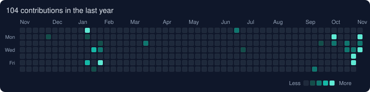

  

  

  
  

  <a href="#-türkçe">🇹🇷 Türkçe</a> &nbsp;•&nbsp; <a href="#-english">🇺🇸 English</a>

---

## 🇹🇷 Türkçe

### 🚀 Projelerim

| Proje | Tarih | Teknolojiler | Açıklama |
| :--- | :---: | :--- | :--- |
| **[🧹 DiskLens](https://github.com/keminbtepe/DiskLens)** | 2026&#8209;10&#8209;30 | PowerShell · WPF | Büyük dosyaları tespit edip disk alanı kazandıran Windows disk analiz aracı. |
| **[📚 KPSS ODAK](https://github.com/keminbtepe/KPSS-ODAK)** | 2026&#8209;10&#8209;14 | React Native · .NET 9 · SQL Server | App Store ve Google Play'de yayında olan sınav hazırlık platformu ve web yönetim paneli. |
| **[💬 Romeris](https://apps.apple.com/tr/app/romeris/id6818265369?l=tr)** | 2026 | ASP.NET Core 8 · SignalR · MySQL · Expo | Anlık mesajlaşmalı sosyal ve canlı etkinlik platformu. [App Store](https://apps.apple.com/tr/app/romeris/id6818265369?l=tr) · [Web](https://romeris.runasp.net/) |
| **[🏦 Kredi Risk Skorlama Sistemi](https://github.com/keminbtepe/Credit-Risk-Score)** | 2026&#8209;04&#8209;18 | SQL Server · Python · XGBoost | SQL Server ETL ve makine öğrenmesiyle kredi temerrüt tahmini, %91 doğruluk. |
| **[🏢 Site Yönetim Sistemi](https://github.com/keminbtepe/HousingEstateManagement)** | 2026&#8209;03&#8209;17 | .NET 9 Web API · React 19 · TypeScript | Aidat ve finans süreçlerini zamanlanmış görevlerle otomatikleştiren site yönetimi. |
| **[📊 Dijital İstifçilik Analizi](https://github.com/keminbtepe/Digital-Hoarding-Analysis)** | 2026&#8209;02&#8209;14 | SPSS · G*Power | Korelasyon, regresyon ve faktör analiziyle istatistiksel modelleme. |
| **[🐍 PyCharmN](https://github.com/keminbtepe/PyCharmN)** | 2025&#8209;10&#8209;12 | Python | Python programlama çalışmaları. |
| **[🗄️ T-SQL Pratik Egzersizler](https://github.com/keminbtepe/T-SQL-Practice-Exercises)** | 2025&#8209;09&#8209;22 | T-SQL | JOIN, fonksiyon, stored procedure, trigger ve transaction örnekleri. |
| **[📓 Python Çalışma Kodları](https://github.com/keminbtepe/Python-Working-Code)** | 2025&#8209;09&#8209;10 | Python · Jupyter | Veri analizi, algoritma ve istatistik çalışmaları. |
| **[🛒 ORAGE: E-Ticaret ve Analiz](https://github.com/keminbtepe/e-Orage-Commerce-Website)** | 2024&#8209;12&#8209;12 | ASP.NET Core MVC · EF Core | Yönetim paneli ve satış analizi içeren katmanlı mimaride e-ticaret sistemi. |
| **[🪙 Bilcoin Bilmece Otomasyonu](https://github.com/keminbtepe/Bilcoin-Bilmece-Otomasyonu)** | 2020&#8209;02&#8209;14 | C# · SQL Server | Skor ve seviye takipli kelime tahmin oyunu. |
| **[🚌 Otobüs Bilet Otomasyonu](https://github.com/keminbtepe/Otobus-Bilet-Otomasyonu)** | 2019&#8209;05&#8209;15 | C# · SQL Server | Sefer yönetimi, koltuk seçimi ve bilet satış otomasyonu. |

<b>📚 Öne çıkan proje: KPSS ODAK</b>

 

KPSS adayları, eğitmenler ve yöneticiler için mobil ve web istemcili sınav hazırlık platformu. App Store ve Google Play'de yayında.

- ASP.NET Core Web API, Clean Architecture, 33 controller ve 232 rota
- Apple ve Google abonelik bildirimleri için imza doğrulamalı, idempotent webhook altyapısı
- PDF'lerden 1.500+ sorunun yapay zekâ destekli ayıklanması, çözümü ve çapraz kontrolü
- Expo SDK 57 mobil uygulama: çevrimdışı önbellek, çalışma serisi, liderlik tablosu, hata havuzu
- React 19 yönetim paneli: müfredat, soru bankası, abonelik, gelir analitiği ve denetim kaydı

---

## 🇺🇸 English

### 🚀 Projects

| Project | Date | Stack | Description |
| :--- | :---: | :--- | :--- |
| **[🧹 DiskLens](https://github.com/keminbtepe/DiskLens)** | 2026&#8209;10&#8209;30 | PowerShell · WPF | Windows disk-usage analyzer that identifies large files and reclaims space. |
| **[📚 KPSS ODAK](https://github.com/keminbtepe/KPSS-ODAK)** | 2026&#8209;10&#8209;14 | React Native · .NET 9 · SQL Server | Exam-prep platform live on App Store & Google Play, with a web admin panel. |
| **[💬 Romeris](https://apps.apple.com/tr/app/romeris/id6818265369?l=tr)** | 2026 | ASP.NET Core 8 · SignalR · MySQL · Expo | Social and live-event platform with real-time messaging. [App Store](https://apps.apple.com/tr/app/romeris/id6818265369?l=tr) · [Web](https://romeris.runasp.net/) |
| **[🏦 Credit Risk Scoring System](https://github.com/keminbtepe/Credit-Risk-Score)** | 2026&#8209;04&#8209;18 | SQL Server · Python · XGBoost | End-to-end ETL and ML loan-default prediction with 91% accuracy. |
| **[🏢 Housing Estate Management](https://github.com/keminbtepe/HousingEstateManagement)** | 2026&#8209;03&#8209;17 | .NET 9 Web API · React 19 · TypeScript | Estate management with scheduled jobs for dues and finance. |
| **[📊 Digital Hoarding Analysis](https://github.com/keminbtepe/Digital-Hoarding-Analysis)** | 2026&#8209;02&#8209;14 | SPSS · G*Power | Statistical modeling with correlation, regression and factor analysis. |
| **[🐍 PyCharmN](https://github.com/keminbtepe/PyCharmN)** | 2025&#8209;10&#8209;12 | Python | Python programming exercises. |
| **[🗄️ T-SQL Practice Exercises](https://github.com/keminbtepe/T-SQL-Practice-Exercises)** | 2025&#8209;09&#8209;22 | T-SQL | Joins, functions, stored procedures, triggers and transactions. |
| **[📓 Python Working Code](https://github.com/keminbtepe/Python-Working-Code)** | 2025&#8209;09&#8209;10 | Python · Jupyter | Data analysis, algorithms and statistics scripts. |
| **[🛒 ORAGE: E-Commerce & Analysis](https://github.com/keminbtepe/e-Orage-Commerce-Website)** | 2024&#8209;12&#8209;12 | ASP.NET Core MVC · EF Core | N-tier e-commerce system with admin panel and sales analytics. |
| **[🪙 Bilcoin Riddle Automation](https://github.com/keminbtepe/Bilcoin-Bilmece-Otomasyonu)** | 2020&#8209;02&#8209;14 | C# · SQL Server | Word-guessing game with score and level tracking. |
| **[🚌 Bus Ticket Automation](https://github.com/keminbtepe/Otobus-Bilet-Otomasyonu)** | 2019&#8209;05&#8209;15 | C# · SQL Server | Trip management, seat selection and ticketing. |

<b>📚 Featured project: KPSS ODAK</b>

 

A mobile and web exam-prep platform for KPSS candidates, instructors and administrators. Live on the App Store and Google Play.

- ASP.NET Core Web API on Clean Architecture with 33 controllers and 232 routes
- Signature-verified, idempotent webhooks for Apple and Google subscriptions
- AI-assisted extraction, solving and cross-checking of 1,500+ questions from PDFs
- Expo SDK 57 mobile app with offline cache, streaks, leaderboards and mistake review
- React 19 admin panel for curriculum, question bank, subscriptions, revenue and audit logs

---

## 🧰 Teknolojiler / Tech Stack

<b>Listeyi aç / Show the list</b>

 

<table>
<tr>
<td><b>AI & Agents</b></td>
<td>

</td>
</tr>
<tr>
<td><b>Languages</b></td>
<td> 
</td>
</tr>
<tr>
<td><b>Backend</b></td>
<td> 

</td>
</tr>
<tr>
<td><b>Mobile & Web</b></td>
<td> 

</td>
</tr>
<tr>
<td><b>Data & ML</b></td>
<td> 

</td>
</tr>
<tr>
<td><b>Databases</b></td>
<td> 

</td>
</tr>
<tr>
<td><b>Tools & Media</b></td>
<td></td>
</tr>
</table>

---

## 📈 GitHub Aktivitem / Activity

  

  

  

  

